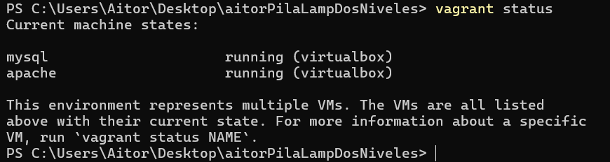
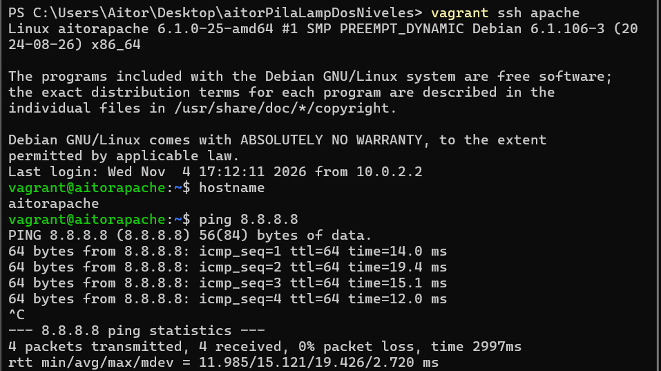
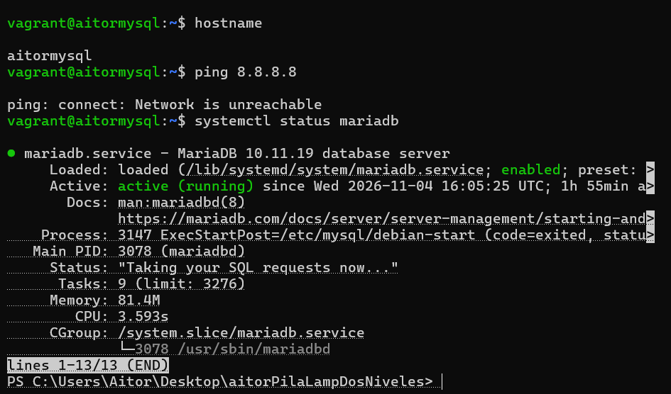
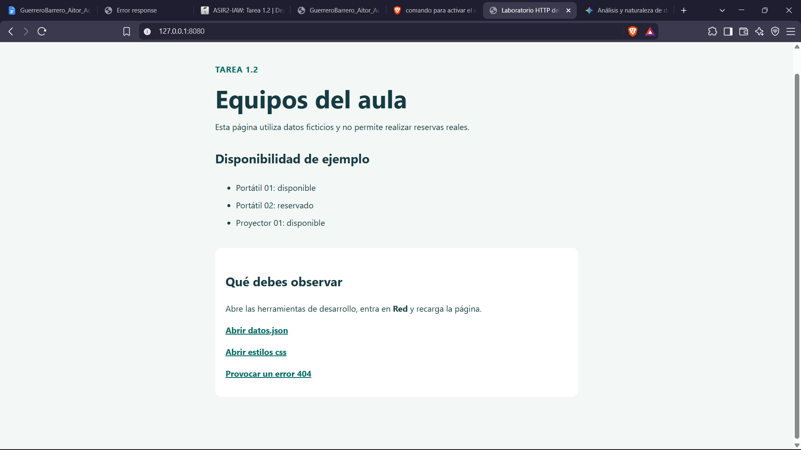

# Infraestructura Pila LAMP de dos niveles con Vagrant
**Autor:** Aitor Guerrero Barrero  
**Módulo:** Implantación de Aplicaciones Web ASIR2
## 1. Introducción
En esta práctica montaremos una infraestructura de dos niveles y se desplegará en ella una aplicación de gestión de usuarios. Usaremos Vagrant para las máquinas virtuales.
 
- **Nivel 1 (frontend):** servidor web Apache + PHP. Es la **única** máquina con acceso a Internet.
- **Nivel 2 (backend):** servidor de base de datos. **Sin acceso a Internet**, solo es accesible desde el servidor web a través de una red interna.
- El acceso desde el equipo anfitrión se hace mediante **reenvío de puertos**.

## 2. Configuración del Vagrantfile 
```ruby
Vagrant.configure("2") do |config|
 
  config.vm.box = "debian/bookworm64"
 
  # Maquina de la base de datos (sin Internet)
  config.vm.define "mysql" do |mysql|
    mysql.vm.hostname = "aitormysql"
    mysql.vm.network "private_network", ip: "192.168.10.11", virtualbox__intnet: "red_interna"
    mysql.vm.provision "shell", path: "provision_mysql.sh"
    # Quita la salida a Internet (se ejecuta siempre que arranca la maquina)
    mysql.vm.provision "shell", run: "always", inline: "ip route del default"
  end
 
  # Maquina del servidor web (con Internet por el NAT)
  config.vm.define "apache" do |apache|
    apache.vm.hostname = "aitorapache"
    apache.vm.network "private_network", ip: "192.168.10.10", virtualbox__intnet: "red_interna"
    apache.vm.network "forwarded_port", guest: 80, host: 8080
    apache.vm.provision "shell", path: "provision_apache.sh"
  end
 
end
```
 
Explicación:
 
- `config.vm.box = "debian/bookworm64"`: imagen base Debian 12.
- `config.vm.define "mysql"` y `"apache"`: define cada máquina. Se crea primero `mysql` para que la base de datos esté lista cuando se cree Apache.
- `vm.hostname`: nombre de cada máquina (`aitormysql` y `aitorapache`).
- `private_network` y `virtualbox__intnet`: red interna entre las dos máquinas (192.168.10.0/24).
- `forwarded_port guest: 80, host: 8080`: el puerto 8080 del equipo anfitrión llega al puerto 80 de Apache.
- `provision "shell", path:`: ejecuta el script bash de cada máquina.
- **Máquina sin Internet:** Vagrant siempre crea una interfaz NAT en cada máquina. Para quitar el acceso a Internet de la máquina de base de datos se borra su ruta por defecto con `ip route del default`. Se hace al final cuando ya se ha instalado todo, y con `run: "always"` para que se repita cada vez que arranca.

## 3. Script de aprovisionamiento de MariaDB (`provision_mysql.sh`)
 
```bash
#!/bin/bash
 
# Actualizar e instalar MariaDB y git
apt-get update
apt-get install -y mariadb-server git
 
# Hacer que MariaDB escuche en la IP de la red interna
sed -i 's/127.0.0.1/192.168.10.11/' /etc/mysql/mariadb.conf.d/50-server.cnf
systemctl restart mariadb
 
# Descargar la aplicacion
git clone https://github.com/josejuansanchez/iaw-practica-lamp.git /tmp/app
 
# Crear la base de datos y el usuario (solo puede entrar desde el servidor apache)
mysql -u root -e "CREATE DATABASE IF NOT EXISTS lamp_db;"
mysql -u root -e "CREATE USER 'lamp_user'@'192.168.10.10' IDENTIFIED BY 'lamp_password';"
mysql -u root -e "GRANT ALL PRIVILEGES ON lamp_db.* TO 'lamp_user'@'192.168.10.10';"
mysql -u root -e "FLUSH PRIVILEGES;"
 
# Importar las tablas de la aplicacion
mysql -u root lamp_db < /tmp/app/db/database.sql
```
 
| Orden | Explicación |
|---|---|
| `apt-get update` | Actualiza la lista de paquetes. |
| `apt-get install -y mariadb-server git` | Instala el servidor de base de datos y git. |
| `sed -i 's/127.0.0.1/192.168.10.11/' ...` | Cambia la dirección en la que escucha MariaDB, de localhost a la IP de la red interna, para que Apache pueda conectarse. |
| `systemctl restart mariadb` | Reinicia el servicio para aplicar el cambio. |
| `git clone ...` | Descarga la aplicación para sacar el fichero SQL. |
| `CREATE DATABASE IF NOT EXISTS lamp_db` | Crea la base de datos de la aplicación. |
| `CREATE USER 'lamp_user'@'192.168.10.10'` | Crea un usuario que solo puede conectarse desde la máquina Apache. |
| `GRANT ALL PRIVILEGES ...` | Da permisos al usuario sobre la base de datos. |
| `FLUSH PRIVILEGES` | Aplica los permisos. |
| `mysql -u root lamp_db < database.sql` | Crea las tablas de la aplicación. |

## 4. Script de aprovisionamiento de Apache (`provision_apache.sh`)
 
```bash
#!/bin/bash
 
# Actualizar e instalar Apache, PHP y git
apt-get update
apt-get install -y apache2 php libapache2-mod-php php-mysql git
 
# Descargar la aplicacion
git clone https://github.com/josejuansanchez/iaw-practica-lamp.git /tmp/app
 
# Copiar la aplicacion a la carpeta web
rm /var/www/html/index.html
cp -r /tmp/app/src/* /var/www/html/
 
# Cambiar la conexion a la base de datos (IP de la maquina mysql)
cat > /var/www/html/config.php <<'EOF2'
<?php
$mysqli = mysqli_connect("192.168.10.11", "lamp_user", "lamp_password", "lamp_db");
?>
EOF2
 
# Reiniciar Apache
systemctl restart apache2
```
 
| Orden | Explicación |
|---|---|
| `apt-get install -y apache2 php libapache2-mod-php php-mysql git` | Instala Apache, PHP, el módulo de PHP para Apache y el conector de PHP con MySQL. |
| `git clone ...` | Descarga la aplicación. |
| `rm /var/www/html/index.html` | Borra la página por defecto de Apache. |
| `cp -r /tmp/app/src/* /var/www/html/` | Copia la aplicación a la carpeta web. |
| `cat > /var/www/html/config.php` | **Ajuste de la aplicación:** la conexión original apuntaba a un host llamado `mysql`. Se reescribe con la IP de la máquina de base de datos y el usuario creado. |
| `systemctl restart apache2` | Reinicia Apache. |

## 5. Comprobaciones
### 5.1 Máquinas creadas  
  
### 5.2 Apache
  
### 5.3 MySQL
  
### 5.4 Funcionamiento
Aplicación en el navegador en http://localhost:8080:  
  
### 5.5 Prueba de funcionamiento en vídeo
El vídeo pesa demasiado para subirlo a GitHub, se encontrará en este enlace: https://drive.google.com/file/d/1qZPCJZ43vXlYooIMQQ9rkRQ6HwOY9SQ-/view?usp=sharing
